# Hardware

Read [SAFETY.md](../SAFETY.md) first.

## The donor box

Any e-nail box with a mains inlet, a coil socket (XLR or 5-pin) and a coil with a built-in
K-type thermocouple will do. The prototype used a small box with a 3-digit display, a
transformer-fed MCU board and a triac. That board came out completely; lever connectors took
its place. A second box type seen during the build uses a generic 48×24 mm PID module with a
relay output; the same conversion applies (mains on terminals 1/2, coil on the relay contact,
thermocouple on the probe terminals).

Before you remove anything, **tape-mark every wire** going to the coil socket: two are the
heater, two are the thermocouple. On the prototype all four were the same colour.

## Parts

| Part | Notes |
|---|---|
| ESP32 dev board, classic ESP32-WROOM-32 | Built on a "MINI D1 ESP32" (double-row headers). Any ESP32 with the pins below free works |
| MAX6675 module | Reads the coil's K thermocouple. 0.25 °C steps, 0–1024 °C |
| SSR-25DA | 3–32 V DC in, AC out. Switches the coil |
| 1-channel 5 V relay module with H/L jumper | Master cut-off. Jumper on **H** |
| HLK-PM01 | 230 V AC → 5 V, 3 W. Solder flying leads on and heat-shrink them |
| EC11 rotary encoder with push switch | Bare encoder, 5 pins |
| 1.12" 128×128 mono OLED, SH1107, SPI | Prototype: Pimoroni Breakout Garden module |
| 3 lever connectors (Wago 221, 3-way) | Live, neutral, 5 V |
| Mains lead, 3 A ceramic fuse | See SAFETY.md |

**Why MAX6675 and not MAX31855?** The MAX31855 reports a fault when the thermocouple junction
touches ground. In a coil you can't be sure it doesn't. The MAX6675 doesn't care. ESPHome's
`max6675` component publishes NaN on an open probe; a missing or unwired module reads exactly
0 °C, so the firmware treats ≤ 0 °C as a fault too.

## ESP32 pin map

| ESP32 | Goes to | Note |
|---|---|---|
| IO18 | MAX6675 SCK + OLED SCK | shared SPI clock |
| IO23 | OLED MOSI | |
| IO19 | MAX6675 SO | |
| IO16 | MAX6675 CS | |
| IO17 | OLED CS | |
| IO4 | OLED DC | |
| IO32 | EC11 A | internal pull-up |
| IO33 | EC11 B | internal pull-up |
| IO25 | EC11 push | other switch leg to GND |
| IO26 | SSR DC+ | SSR DC− to GND. No resistor needed |
| IO27 | Relay IN | relay jumper on H |
| 3V3 | MAX6675 VCC, OLED pin 1 | |
| 5V (VCC) | HLK-PM01 +Vo, relay DC+ | **never** the OLED or the MAX6675 |
| GND | HLK −Vo, relay DC−, SSR DC−, MAX6675, OLED, EC11 C + switch | one star point |

OLED pin 6 stays unconnected. If you change a pin, change `firmware/enail.yaml` to match.

## Mains side

- **Wago 1 (live):** inlet L, HLK-PM01 AC, relay COM.
- **Wago 2 (neutral):** inlet N, HLK-PM01 AC, coil heater wire (the one that was on the old board's neutral).
- **Relay NO → SSR terminal 1. SSR terminal 2 → the other coil heater wire.** Relay NC stays empty.
- **Earth:** inlet earth straight to the coil socket shell; also to a case screw if the case is metal.
- **Wago 3 (5 V):** HLK-PM01 +Vo, ESP32 5V/VCC, relay DC+.
- HLK-PM01 −Vo to the common GND.
- Coil socket probe + and − to MAX6675 T+ and T−.

The coil draws under 1 A, so the SSR needs no heatsink. Fix the HLK-PM01, relay and SSR down on
the mains side of the box; only low-voltage wires cross to the ESP32 side.

## Low-voltage side

The ESP32 Mini has one 3.3 V pin and one IO18 but needs to feed two modules, and has only three
GND pins. On the prototype a small breadboard is used **as a junction only** (rails for GND and
3.3 V, five columns for the MAX6675). The ESP32 itself stays out of the breadboard and is wired
with jumpers straight onto its pins.

Two checks once it's powered on USB:

- **Probe polarity:** pinch the probe tip. The reading should rise. If it falls, swap T+ and T−.
- **Dial direction:** clockwise should raise the target. If not, swap A and B.

## Build notes

- Some breadboards split their rails halfway along. Keep each rail's wires on one half.
- The OLED's header pins end up exposed if the screen sits in the lid. Tape over them: a metal
  tool across them resets the ESP32, which ends the session.
- The prototype's OLED runs at 1 MHz SPI in mode 0. The 8 MHz default garbled the picture over
  jumper wires and mode 3 dropped frames.
